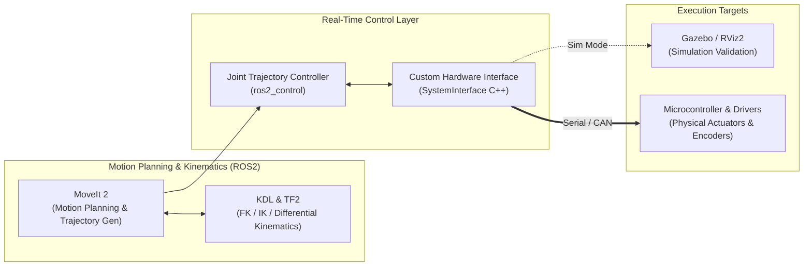

# Multi-DOF Robotic Manipulator

**Role:** Robotics Engineer (Individual Project)  
**Stack:** ROS2 (Humble/Foxy), MoveIt 2, `ros2_control`, KDL, TF2, Gazebo, RViz2, C++, Python, Embedded C/C++

---

## Overview

End-to-end hardware assembly, embedded integration, and ROS2 manipulation stack for an open-source multi-DOF robotic arm. The project bridges mathematical kinematics/control foundations with custom `ros2_control` hardware interfaces, progressing from simulation validation to physical hardware execution.

---

## System & Control Architecture

---

## Key Engineering Highlights

* **Hardware & Embedded Integration:** Assembled, wired, and soldered an open-source robotic arm from scratch, implementing microcontroller interfacing, actuator drivers, and sensor/power electronics.
* **Mathematical & Algorithmic Foundations:** Applied spatial transformations, forward/inverse and differential kinematics, and control theory in practice via **TF2**, **KDL**, and **`ros2_control`** respectively.
* **Full ROS2 Manipulation Progression:** Developed custom `ros2_control` hardware interfaces, validating **MoveIt 2** motion planning and trajectory execution in Gazebo/RViz2 simulation before deploying on physical hardware.

---

## Media & Demonstration

* **Simulation Execution:** *(Add link/GIF of MoveIt 2 trajectory planning in RViz2/Gazebo)*
* **Physical Hardware Deployment:** *(Add link/video of physical arm executing planned trajectories)*

[⬅ Back to Portfolio Overview](../README.md)
