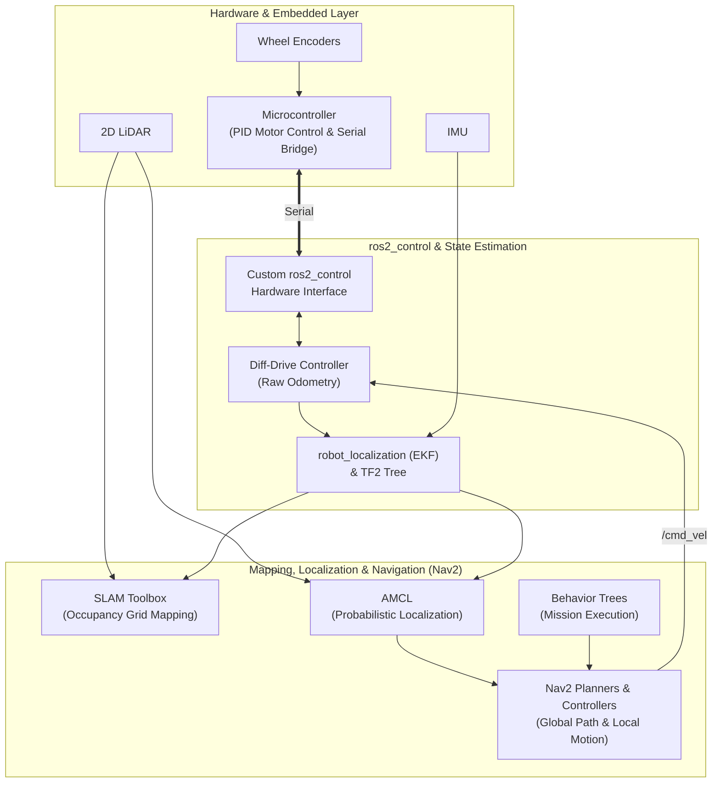

# Indoor Autonomous Mobile Robot (TurtleBot-Based)

**Role:** Robotics Engineer (Individual Project)  
**Stack:** ROS2 (Humble/Foxy), Nav2, SLAM Toolbox, AMCL, `robot_localization` (EKF), `ros2_control`, TF2, Behavior Trees, Gazebo, RViz2, C++, Python

---

## Overview

Full-stack hardware assembly, low-level embedded control, and autonomous navigation pipeline for a TurtleBot-based differential-drive mobile robot. Built from scratch to validate sensor-fused odometry, SLAM mapping, probabilistic localization, and Behavior Tree mission execution in simulation prior to real-world deployment.

---

## Autonomy & Navigation Architecture

---

## Key Engineering Highlights

* **Hardware & Embedded Integration:** Assembled, wired, and soldered an open-source mobile chassis, implementing microcontroller interfacing, motor drivers, and multi-sensor integration (encoders, IMU, 2D LiDAR).
* **Mathematical & Algorithmic Foundations:** Applied differential-drive kinematics, Extended Kalman Filtering (EKF), probabilistic localization, and path/motion planning theory in practice through **TF2**, **`robot_localization`**, **SLAM Toolbox**, **AMCL**, and **Nav2** respectively.
* **ROS2 Navigation & Control Stack:** Developed custom `ros2_control` hardware interfaces, PID motor controllers, and sensor-fused odometry, validating SLAM mapping, AMCL localization, path/motion planning, and Behavior Tree mission execution in simulation before deploying on physical hardware.

---

## Media & Demonstration

* **SLAM Mapping & Nav2 in Simulation:** *(Add link/GIF of SLAM Toolbox & Nav2 path execution in RViz2)*
* **Physical Hardware Navigation:** *(Add link/video of real-world autonomous navigation and obstacle avoidance)*

[⬅ Back to Portfolio Overview](../README.md)
